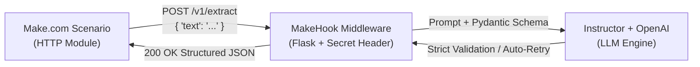

# MakeHook 🪝

> **Lightweight, production-grade LLM webhook middleware for [Make.com](https://www.make.com) scenarios.**
> Transform noisy, unstructured customer text into strictly validated, type-safe JSON using **Instructor**, **OpenAI / LiteLLM**, and **Pydantic v2**.

---

## 🎯 Overview

Make.com workflows often ingest unstructured text from sources such as:
- Support contact forms
- Unformatted incoming emails & tickets
- Slack / Discord channel webhooks
- Survey feedback fields

Standard LLM completions are prone to formatting quirks and schema drift. **MakeHook** sits as a middleware webhook that accepts raw text, pipes it through an LLM constrained with **Instructor** and **Pydantic v2**, and guarantees response shape validation (with automatic retries on validation failure) before delivering structured JSON back to your scenario.

---

## 🏗 Architecture & Flow



---

## 🚀 Features

- **Strict Schema Enforcement**: Powered by **Pydantic v2** and **Instructor** to guarantee exact data types and bounds.
- **Auto-Retries**: If the LLM generates a response missing a field or violating constraints, Instructor feeds validation errors back to the model for self-correction.
- **Shared Secret Security**: Authenticate requests with custom `X-MakeHook-Secret` headers.
- **OpenAI & LiteLLM Ready**: Easily point to OpenAI, Azure OpenAI, or a self-hosted LiteLLM / Ollama endpoint via `OPENAI_BASE_URL`.
- **Offline Test Suite**: 100% mocked unit tests with `pytest` that run in CI/CD without hitting live API tokens.

---

## 📦 Project Structure

```
makehook/
├── app/
│   ├── __init__.py
│   ├── main.py          # Flask application and route handlers
│   ├── schemas.py       # Pydantic v2 extraction models
│   └── extractor.py     # Instructor LLM processing logic
├── tests/
│   ├── __init__.py
│   └── test_extractor.py# Unit tests with mocked LLM outputs
├── .env.example         # Environment template
├── .gitignore
├── README.md
└── requirements.txt
```

---

## ⚙️ Quickstart & Local Setup

### 1. Clone & Set Up Environment

```bash
git clone https://github.com/commey/makehook.git
cd makehook

# Create virtual environment
python -m venv .venv

# Activate virtual environment
# Windows:
.venv\Scripts\activate
# Linux/macOS:
source .venv/bin/activate

# Install dependencies
pip install -r requirements.txt
```

### 2. Configure Environment Variables

Copy `.env.example` to `.env`:

```bash
cp .env.example .env
```

Edit `.env` to configure your settings:

```ini
PORT=5000
MAKEHOOK_SECRET=my_secure_webhook_secret_123
OPENAI_API_KEY=sk-proj-...
LLM_MODEL=gpt-4o-mini
```

> **Note:** If `MAKEHOOK_SECRET` is left blank, secret checking is bypassed for quick local testing.

### 3. Run the Service

```bash
python -m app.main
```

Service starts on `http://127.0.0.1:5000`.

---

## 🧪 Testing

Run unit tests offline (no external network or LLM tokens required):

```bash
pytest -v
```

---

## 📡 API Reference

### 1. Health Check
`GET /health`

**Response (`200 OK`):**
```json
{
  "status": "ok"
}
```

---

### 2. Extract Insights
`POST /v1/extract`

**Headers:**
- `Content-Type: application/json`
- `X-MakeHook-Secret: <your_secret>` *(optional if unset in env)*

**Request Body:**
```json
{
  "text": "Hi, I am Alex Rivera. My team can't access the dashboard after yesterday's update and our client presentations start in an hour. Please fix this immediately or call me back at +1-555-0199."
}
```

**Response (`200 OK`):**
```json
{
  "customer_name": "Alex Rivera",
  "category": "support",
  "urgency": "critical",
  "summary": "Alex Rivera reports inability to access the dashboard post-update, affecting imminent client presentations.",
  "action_items": [
    {
      "description": "Investigate and resolve dashboard outage post-update",
      "assignee": "Engineering"
    },
    {
      "description": "Contact Alex Rivera regarding resolution status",
      "assignee": "Support"
    }
  ],
  "sentiment_score": -0.85
}
```

---

## 🔗 Make.com Integration Guide

Follow these steps to plug MakeHook into your Make.com scenario:

### Step 1: Expose MakeHook Publicly (Development)
If running locally, use Ngrok:
```bash
ngrok http 5000
```
Note the HTTPS forwarding URL (e.g., `https://xyz.ngrok-free.app`).

### Step 2: Configure Make.com Scenario
1. Add an **HTTP ("Make a request")** module to your scenario.
2. Configure the module fields:
   - **URL**: `https://your-domain.com/v1/extract`
   - **Method**: `POST`
   - **Headers**:
     - `Content-Type`: `application/json`
     - `X-MakeHook-Secret`: `[Your secret token]`
   - **Body type**: `Raw`
   - **Content type**: `JSON (application/json)`
   - **Request content**:
     ```json
     {
       "text": "{{1.unstructured_text_field}}"
     }
     ```
   - **Parse response**: `Yes`
3. Click **Run once** to test.
4. Downstream modules (Slack, Airtable, Notion, CRM) can now directly map typed fields like `customer_name`, `urgency`, `action_items[]`, etc.

---

## 🛡️ Production Deployment

For production environments, run MakeHook behind a WSGI server like **Gunicorn**:

```bash
gunicorn -w 4 -b 0.0.0.0:5000 "app.main:app"
```

---

## 📄 License

This project is licensed under the [MIT License](LICENSE).
